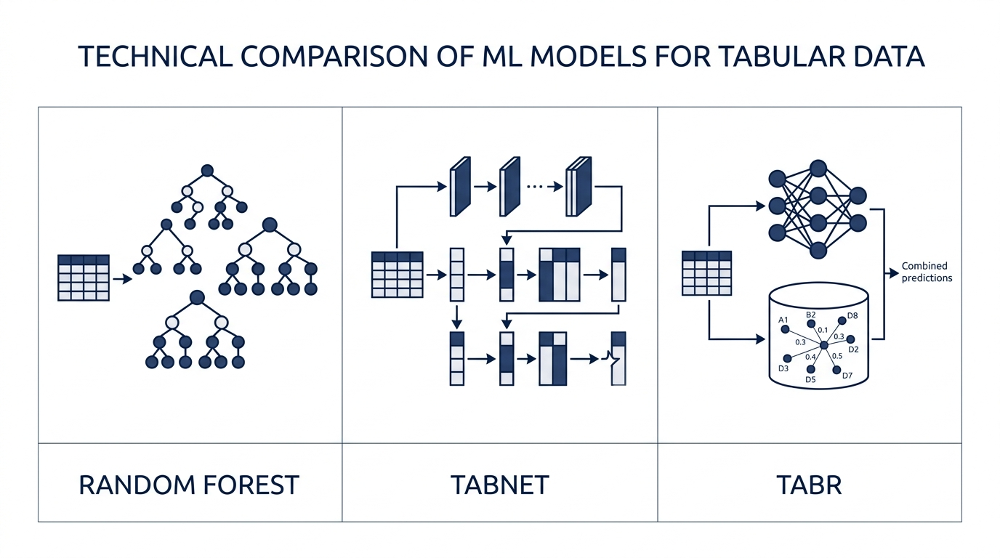
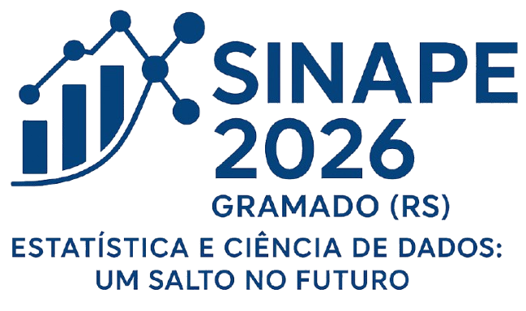

# Classificação de Dados SAR/PolSAR usando TabR e TabNet

[-05437a?style=flat-square)](https://sinape2026.com.br/)
[](https://quarto.org/)
[](https://revealjs.com/)
[](LICENSE)

Apresentação oral apresentada no **26º Simpósio Nacional de Probabilidade e Estatística (SINAPE)**, realizado em Gramado (RS) em Setembro de 2026.

---

## 👥 Autores

- **Marcelo R. Rios** — Departamento de Estatística, Universidade Federal de Pernambuco (UFPE)
- **Jodavid Ferreira** — Departamento de Estatística, Universidade Federal de Pernambuco (UFPE)  
  📧 [jodavid.ferreira@ufpe.br](mailto:jodavid.ferreira@ufpe.br) | 🌐 [jodavid.github.io](https://jodavid.github.io)

---

## 📌 Visão Geral do Trabalho

Os dados de **Radar de Abertura Sintética Polarimétrico (PolSAR)** geram estruturas ricas de informação, representadas por matrizes de covariância hermitianas $3 \times 3$, mas enfrentam desafios inerentes como a presença do ruído *speckle* e complexas fronteiras de decisão entre classes de cobertura do solo.

Tradicionalmente, métodos de aprendizado de máquina como **Random Forest (RF)** são referências consolidadas no sensoriamento remoto. Este trabalho investiga e compara o desempenho de duas arquiteturas de **Deep Learning para dados tabulares** frente ao Random Forest:

1. **TabNet** *(Arik & Pfister, 2021)*: Modelo baseado em mecanismos de atenção sequencial esparsa (*sparsemax*) com passos de decisão interpretáveis e blocos de transformação de características (*Feature Transformers* com GLU).
2. **TabR** *(Gorishniy et al., 2023)*: Modelo aumentado por recuperação (*Retrieval-Augmented Tabular Learning*), que combina representações neurais latentes com busca de vizinhos mais próximos no conjunto de treino via atenção cruzada.
3. **Random Forest** *(Breiman, 2001)*: Ensemble baseado em *bagging* e divisão aleatória de atributos como *baseline* competitivo.

<p align="center">
  
</p>

---

## 🛰️ Dados Experimentais

Foram utilizadas duas cenas clássicas de dados PolSAR multi-look:

| Região / Sensor | Sensor / Frequência | Número de Classes | Classes de Cobertura | Amostras por Área |
| :--- | :--- | :---: | :--- | :---: |
| **São Francisco** | AIRSAR (NASA/JPL) — Banda C | 3 | Água, Vegetação, Área Urbana | $31 \times 31$ (961 px) |
| **Foulum** | EMISAR (Dinamarca) — Banda C | 6 | Trigo, Colza, Centeio, Conífera, Aveia, Background | 961 a 1.861 px |

**Variáveis preditoras utilizadas:** Vetor de intensidades polarimétricas $\mathbf{I} = [|Z_{HH}|^2, |Z_{HV}|^2, |Z_{VV}|^2]^\top \in \mathbb{R}^3_+$.

---

## 📊 Principais Resultados

### 1. Cena de São Francisco (AIRSAR — 3 Classes)

O **TabR** obteve o melhor desempenho global, proporcionando maior nitidez na separação entre as classes e menor fragmentação de bordas em comparação ao Random Forest.

| Modelo | Acurácia Global | Coeficiente Kappa ($\kappa$) |
| :--- | :---: | :---: |
| Random Forest | 83,18% | 0,7477 |
| TabNet | 84,71% | 0,7706 |
| **TabR** | **85,88%** | **0,7882** |

---

### 2. Cena de Foulum (EMISAR — 6 Classes)

Em um cenário mais complexo, com maior número de classes agrícolas e alta similaridade de espalhamento espectral, o **TabNet** alcançou a maior acurácia e melhor concordância Kappa.

| Modelo | Acurácia Global | Coeficiente Kappa ($\kappa$) |
| :--- | :---: | :---: |
| TabR | 86,49% | 0,8355 |
| Random Forest | 87,12% | 0,8423 |
| **TabNet** | **87,60%** | **0,8489** |

---

## 💡 Conclusões

- Modelos de **Deep Learning para dados tabulares** (TabR e TabNet) superam o Random Forest em dados PolSAR, demonstrando grande potencial na extração de padrões em dados com ruído *speckle*.
- A superioridade relativa varia de acordo com a complexidade da cena:
  - **TabR** destacou-se no cenário com menor número de classes e fronteiras bem definidas.
  - **TabNet** mostrou maior capacidade adaptativa em problemas com maior variabilidade intra-classe e maior número de classes.

---

## 📁 Estrutura do Repositório

```text
.
├── index.qmd                   # Código-fonte da apresentação em Quarto (Reveal.js)
├── index.html                  # Apresentação compilada pronta para exibição web
├── Apresentacao_SINAPE_Final.pdf # Versão em PDF dos slides para leitura e impressão
├── css/
│   └── sinape.css              # Folha de estilos personalizada (tema SINAPE 2026)
├── images/                     # Diagramas, gráficos, mapas temáticos e logotipos
├── index_files/                # Dependências geradas pelo Quarto / Reveal.js
└── README.md                   # Este arquivo
```

---

## 🖥️ Como Visualizar a Apresentação

### Opção 1: Visualização Online (GitHub Pages)
Se o GitHub Pages estiver habilitado para este repositório, acesse diretamente no navegador pelo link gerado (por exemplo, `https://<usuario>.github.io/<repositorio>/`).

### Opção 2: Visualização Local (HTML)
Clone o repositório e abra o arquivo `index.html` em qualquer navegador web moderno:
```bash
git clone https://github.com/<seu-usuario>/<nome-do-repositorio>.git
cd <nome-do-repositorio>
# No Linux:
xdg-open index.html
# No macOS:
open index.html
# No Windows:
start index.html
```

### Opção 3: Visualização em PDF
Consulte o arquivo [`Apresentacao_SINAPE_Final.pdf`](Apresentacao_SINAPE_Final.pdf) diretamente no GitHub ou leitor de PDF de sua preferência.

---

## 🛠️ Como Renderizar / Compilar

Para compilar ou editar a apresentação localmente, é necessário ter o [Quarto CLI](https://quarto.org/docs/get-started/) instalado (versão $\ge 1.3$).

### Pré-visualização com Live Reload:
```bash
quarto preview index.qmd
```

### Renderização para HTML (Reveal.js):
```bash
quarto render index.qmd
```

### Exportação para PDF (via DeckTape):
```bash
npx decktape reveal index.html Apresentacao_SINAPE_Final.pdf
```
*(ou simplesmente utilize a opção de impressão do navegador via tecla `E` no Reveal.js)*.

---

## 📚 Referências Principais

1. **Arik, S. O. & Pfister, T.** (2021). *TabNet: Attentive Interpretable Tabular Learning*. AAAI Conference on Artificial Intelligence.
2. **Gorishniy, Y., Rubachev, I., et al.** (2023). *TabR: Tabular Deep Learning Meets Nearest Neighbors*. arXiv preprint arXiv:2307.14338.
3. **Breiman, L.** (2001). *Random Forests*. Machine Learning, 45(1), 5–32.
4. **Belgiu, M. & Drăguţ, L.** (2016). *Random Forest in Remote Sensing: A Review*. ISPRS Journal of Photogrammetry and Remote Sensing, 114, 24–31.
5. **Ferreira, J. A., Coêlho, H., & Nascimento, A. D.** (2021). *A family of divergence-based classifiers for PolSAR imagery*. International Journal of Remote Sensing, 42(4), 1201–1229.
6. **Lee, J.-S. & Pottier, E.** (2017). *Polarimetric Radar Imaging: From Basics to Applications*. CRC Press.

---

## 🎓 Agradecimentos e Apoio

Agradecemos ao **Departamento de Estatística da UFPE**, à **FACEPE** pelo apoio financeiro à pesquisa e à comissão organizadora do **26º SINAPE**.

<p align="center">
  
  &emsp;&emsp;
  
</p>

---

## 📄 Licença

Este projeto está sob a licença [MIT](LICENSE).
