##  {background-image="images/capa_pb.png" background-opacity=".1" background-size="80%"}

 
 

<h2 style="color:#05437a;">Classificação de Dados SAR/PolSAR</h2>
<h2 style="color:#05437a;">usando TabR e TabNet</h2>

 

<h4 style="color:#7fb3d8;">Marcelo R. Rios e **Jodavid Ferreira**</h4>
<h4 style="colorgray;">Departamento de Estatística — Universidade Federal de Pernambuco</h4>

 

26º SINAPE — Gramado (RS) — Setembro de 2026

---

##
<h2 style="color:#1a3a5c;">Estrutura da Apresentação</h2>

 

:::: {.columns}

::: {.column width="48%"}

1. **Motivação e Objetivo**
2. **Dados SAR/PolSAR**
3. **Modelo: Random Forest**
4. **Modelo: TabNet**
   - Atenção sequencial
   - Feature Transformer
5. **Modelo: TabR**
   - Retrieval-augmented
:::

::: {.column width="48%"}

6. **Dados Experimentais**
   - São Francisco (AIRSAR)
   - Foulum (EMISAR)
7. **Resultados**
   - Métricas de avaliação
   - Mapas de classificação
8. **Conclusões**
9. **Referências**

:::

::::

---

##
<h2 style="color:#1a3a5c;">Motivação</h2>

 

- Sensoriamento remoto por radar de abertura sintética (**SAR/PolSAR**) gera dados com características complexas:
  - Altas dimensionalidades
  - Presença do ruído **speckle**
  - Dados tabulares derivados de matrizes de covariância

. . .

- Modelos clássicos como **Random Forest** são utilizados como métodos de classificação de dados em sensoriamento remoto

. . .

- Recentemente, arquiteturas de **Deep Learning** voltadas para dados tabulares surgiram:
  - **TabNet** (Arik & Pfister, 2021) — Atenção sequencial
  - **TabR** (Gorishniy et al., 2023) — Retrieval-augmented

. . .

<strong>Objetivo:</strong> Comparar o desempenho de Random Forest, TabNet e TabR na classificação de dados SAR/PolSAR

---

##
<h2 style="color:#1a3a5c;">O que é SAR?</h2>

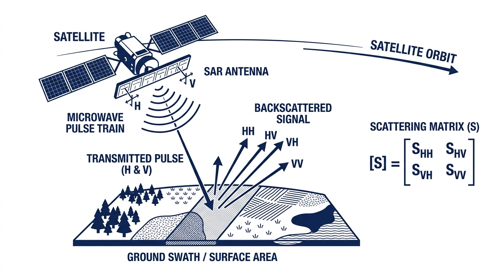{.fixed width=55%}

- **SAR** (*Synthetic Aperture Radar*): sensor ativo que emite pulsos de micro-ondas e mede o sinal retroespalhado

- Funciona **dia e noite**, independente de condições climáticas

---

##
<h2 style="color:#1a3a5c;">Dados PolSAR Multi-look</h2>

 

Os retornos PolSAR multi-look são representados por uma **matriz hermitiana** definida positiva $3 \times 3$:

$$
\mathbf{Z} = \begin{bmatrix}
|Z_{HH}|^2 & Z_{HH-HV} & Z_{HH-VV} \\
Z_{HH-HV}^* & |Z_{HV}|^2 & Z_{HV-VV} \\
Z_{HH-VV}^* & Z_{HV-VV}^* & |Z_{VV}|^2
\end{bmatrix}
$$

onde os **produtos internos** entre canais de polarização são:

$$
Z_{A-B} = \langle Z_A, Z_B \rangle = Z_A Z_B^*,\quad A,B \in \{HH, HV, VV\}
$$

. . .

 

<strong>Variáveis utilizadas:</strong> Vetor de intensidades $\mathbf{I}(i) = [I_1(i), I_2(i), I_3(i)]^\top \in \mathbb{R}^3_+$ correspondente aos canais $HH$, $HV$ e $VV$ no pixel $i$.

---

##
<h2 style="color:#1a3a5c;">Métodos - RF, TabNet e TabR</h2>

{.fixed width=80%}

---

##
<h2 style="color:#1a3a5c;">Random Forest</h2>

O **Random Forest** (Breiman, 2001) é um método de *ensemble* baseado em árvores de decisão:

:::: {.columns}

::: {.column width="60%"}

1. **Bagging**: $B$ subconjuntos bootstrap do treino
2. **Árvores de decisão**: em cada nó, seleciona-se aleatoriamente $m$ variáveis ($m \ll p$)
3. **Agregação**: classificação por **votação majoritária**

$$
\hat{y}(\mathbf{x}) = \text{mode}\{h_b(\mathbf{x})\}_{b=1}^B
$$

:::

::: {.column width="38%"}

**Vantagens:**

- Robusto a *overfitting*
- Lida com variáveis heterogêneas
- Não requer normalização
- É utilizada em aplicações de sensoriamento remoto (Belgiu & Drăguţ, 2016)

:::

::::

:::: {.columns}

::: {.column width="45%"}
onde:

- $\mathbf{x} \in \mathbb{R}^p$ é o vetor de covariáveis (variáveis preditoras) de uma nova observação — no contexto PolSAR, $\mathbf{x} = [I_1, I_2, I_3]^\top$ representa as intensidades dos canais $HH$, $HV$ e $VV$
- $p$ é o número total de variáveis preditoras disponíveis
- $B$ é o número de árvores de decisão no ensemble

:::

::: {.column width="50%"}

- $h_b(\mathbf{x})$ é a classe predita pela $b$-ésima árvore para a observação $\mathbf{x}$, com $b = 1, \ldots, B$
- $m \ll p$ é o número de variáveis sorteadas aleatoriamente em cada nó de divisão da árvore (tipicamente $m = \lfloor\sqrt{p}\rfloor$ para classificação)
- $\text{mode}\{\cdot\}$ denota a moda do conjunto, ou seja, a classe votada pela maioria das $B$ árvores

:::

::::

---

##
<h2 style="color:#1a3a5c;">TabNet — Arquitetura Geral</h2>
<h4 style="color:#7fb3d8;">Attentive Interpretable Tabular Learning</h4>

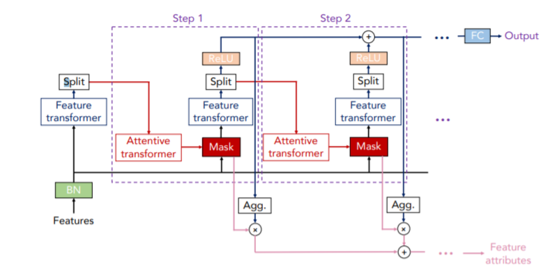{.fixed width=35%}

:::: {.columns}

::: {.column width="50%"}

- **Mecanismo de atenção sequencial**: seleciona variáveis relevantes a cada passo $j = 1, \ldots, N_{\text{steps}}$, onde $N_{\text{steps}}$ é o número total de passos de decisão

:::

::: {.column width="48%"}

- **BN** (*Batch Normalization*): normaliza $\mathbf{f} \in \mathbb{R}^p$ — o vetor de $p$ features de entrada — antes do processamento; $\mathbf{f}$ representa as covariáveis brutas do pixel a ser classificado

:::

::::

- **Interpretabilidade**: fornece importância de variáveis via máscaras de atenção $\mathbf{M}[j] \in \mathbb{R}^p$, onde cada componente indica o peso atribuído à $j$-ésima feature no passo atual

---

##
<h2 style="color:#1a3a5c;">TabNet — Atenção Sequencial</h2>

 

A máscara de atenção no passo $j$ é:

$$
\mathbf{M}[j] = \text{sparsemax}\left(\mathbf{P}[j-1] \cdot h_j(\mathbf{a}[j-1])\right)
$$

onde:

- $\mathbf{M}[j] \in \mathbb{R}^p$ é a **máscara de atenção** no passo $j$: vetor de pesos que indica quais das $p$ variáveis de entrada são selecionadas naquele passo
- $\text{sparsemax}(\cdot)$ é uma função de normalização esparsa — similar ao $\text{softmax}$, mas que produz vetores com muitos zeros, forçando esparsidade na seleção de variáveis
- $\mathbf{P}[j-1] \in \mathbb{R}^p$ é o **prior scale** do passo anterior, que penaliza variáveis já muito utilizadas nos passos anteriores:

$$
\mathbf{P}[j] = \prod_{k=1}^{j}\left(\gamma - \mathbf{M}[k]\right)
$$

com $\mathbf{P}[0] = \mathbf{1}_p$ (vetor de uns, sem penalização no início), e $k$ indexando os passos já percorridos

---

##
<h2 style="color:#1a3a5c;">TabNet — Atenção Sequencial</h2>

- $\gamma \in [1,+\infty)$ é o coeficiente de **relaxamento**: quando $\gamma = 1$ cada variável só pode ser usada uma vez; valores maiores permitem reuso
- $h_j(\cdot)$ é uma rede neural FC (*Fully Connected*) + BN (*Batch Normalization*) específica do passo $j$, que mapeia o estado $\mathbf{a}[j-1]$ para logits de atenção
- $\mathbf{a}[j-1] \in \mathbb{R}^{N_a}$ é o **estado processado** no passo anterior, produzido pelo *Feature Transformer*; $N_a$ é a dimensão da representação interna

:::: {.columns}

::: {.column width="48%"}

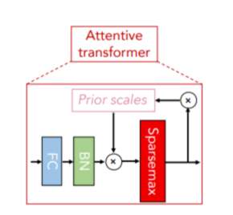{.fixed width=50%}

:::

::: {.column width="48%"}

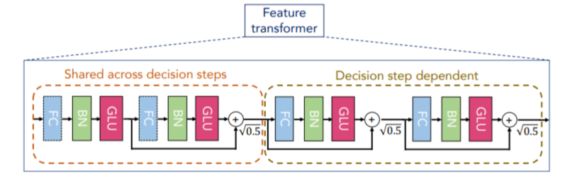{.fixed width=100%}

:::

::::

---

##
<h2 style="color:#1a3a5c;">TabNet — Feature Transformer</h2>

O **Feature Transformer** processa os dados selecionados em cada passo de decisão:

:::: {.columns}
::: {.column width="48%"}
- Combina dois blocos:
  1. **Compartilhado** entre todos os passos
:::
::: {.column width="48%"}
 

  2. **Dependente** de cada passo
:::
::::

. . .

Cada bloco consiste em:

$$
\text{FC} \rightarrow \text{BN} \rightarrow \text{GLU}
$$

onde **GLU** (*Gated Linear Unit*) é:

$$
\text{GLU}(\mathbf{x}) = \sigma(\mathbf{W}_1 \mathbf{x} + \mathbf{b}_1) \odot (\mathbf{W}_2 \mathbf{x} + \mathbf{b}_2)
$$

---

##
<h2 style="color:#1a3a5c;">TabNet — Feature Transformer</h2>

- $\mathbf{x} \in \mathbb{R}^{N_a}$ é o vetor de representações internas da camada anterior (saída da BN), com $N_a$ sendo a dimensão do espaço de representação
- $\mathbf{W}_1, \mathbf{W}_2 \in \mathbb{R}^{N_a \times N_a}$ são **matrizes de pesos** aprendíveis: $\mathbf{W}_1$ controla a "porta" (gate) e $\mathbf{W}_2$ controla o conteúdo a ser filtrado
- $\mathbf{b}_1, \mathbf{b}_2 \in \mathbb{R}^{N_a}$ são os vetores de **viés** (*bias*) associados a cada transformação linear
- $\sigma(\cdot)$ é a **função sigmoide** $\sigma(z) = (1 + e^{-z})^{-1}$, que comprime os valores para o intervalo $(0,1)$, funcionando como uma **porta de controle** sobre o fluxo de informação
- $\odot$ denota o **produto de Hadamard** (element-wise): multiplica elemento a elemento os dois vetores, efetivamente escalando cada dimensão de $(\mathbf{W}_2\mathbf{x} + \mathbf{b}_2)$ pelo gate $\sigma(\mathbf{W}_1\mathbf{x} + \mathbf{b}_1) \in (0,1)^{N_a}$

. . .

A saída do passo $j$ é dividida: parte vai para a **decisão** e parte para as **informações de atenção** do passo seguinte.

---

##
<h2 style="color:#1a3a5c;">TabR — Arquitetura Geral</h2>
<h4 style="color:#7fb3d8;">Tabular Deep Learning Meets Nearest Neighbors</h4>

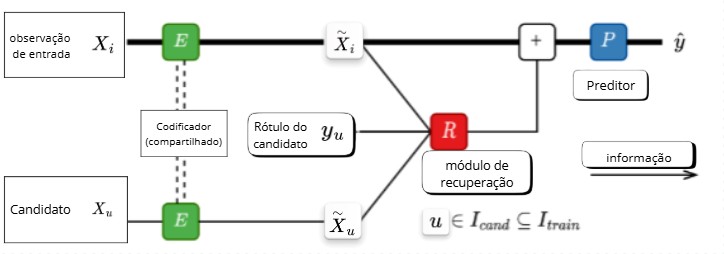{.fixed width=50%}

O TabR pertence à classe de **retrieval-augmented deep learning models**, combinando:

:::: {.columns}

::: {.column width="50%"}

- **Componente paramétrico**: rede neural composta por um **codificador** $E: \mathbb{R}^p \to \mathbb{R}^d$ (que projeta as $p$ covariáveis para um espaço latente de dimensão $d$) e um **preditor** $P: \mathbb{R}^d \to \mathcal{Y}$ (que mapeia a representação enriquecida para o espaço de classes $\mathcal{Y}$)

:::

::: {.column width="48%"}

- **Componente não-paramétrico**: módulo de **recuperação** (*retrieval*) que, dado o vetor latente $\tilde{\mathbf{x}}_i = E(\mathbf{x}_i)$ da observação de consulta $i$, busca os $k$ vizinhos mais similares em $I_{\text{train}}$ (índice do conjunto de treino) e agrega suas informações de rótulo como contexto

:::

::::

---

##
<h2 style="color:#1a3a5c;">TabR — Formalização Matemática</h2>

Dada uma observação $\mathbf{x}_i \in \mathbb{R}^p$ (vetor de $p$ covariáveis do pixel $i$ a classificar), o TabR opera em três etapas:

**1. Codificação (Encoder $E$):**

$$
\tilde{\mathbf{x}}_i = E(\mathbf{x}_i) \in \mathbb{R}^d
$$

onde $E(\cdot)$ é a rede neural codificadora (MLP) com parâmetros aprendíveis, e $d$ é a dimensão do espaço latente de representação ($d \ll p$ em geral)

. . .

**2. Recuperação (Retrieval $R$):**

Para cada candidato $u \in I_{\text{cand}} \subseteq I_{\text{train}}$ — onde $I_{\text{train}}$ é o conjunto de índices de todas as observações de treino e $I_{\text{cand}}$ é um subconjunto candidato (pode ser todo $I_{\text{train}}$) — calcula-se a similaridade do cosseno entre as representações latentes:

$$
s(i,u) = \frac{\tilde{\mathbf{x}}_i^\top \tilde{\mathbf{x}}_u}{\|\tilde{\mathbf{x}}_i\| \cdot \|\tilde{\mathbf{x}}_u\|}
$$

onde $\tilde{\mathbf{x}}_i^\top \tilde{\mathbf{x}}_u$ é o produto interno entre os vetores latentes e $\|\cdot\|$ denota a norma Euclidiana. O valor $s(i,u) \in [-1, 1]$ mede o ângulo entre os vetores: quanto mais próximo de $1$, mais similares as observações $i$ e $u$.

---

##
<h2 style="color:#1a3a5c;">TabR — Formalização Matemática</h2>

A informação de contexto recuperada, agregando os $k$ vizinhos mais similares ($\text{Top-}k$), é:

$$
\mathbf{c}_i = \sum_{u \in \text{Top-}k} \alpha_u \cdot \phi(y_u)
$$

onde $\alpha_u \propto \exp(s(i,u)/\tau)$ são pesos de atenção softmax (com temperatura $\tau > 0$) normalizados sobre os $k$ vizinhos; $y_u \in \mathcal{Y}$ é o rótulo de classe do vizinho $u$ no treino; e $\phi: \mathcal{Y} \to \mathbb{R}^d$ é uma função de embedding que projeta o rótulo para o espaço latente

. . .

**3. Predição ($P$):**

$$
\hat{y}_i = P\left(\tilde{\mathbf{x}}_i + \mathbf{c}_i\right)
$$

onde $\hat{y}_i \in \mathcal{Y}$ é a classe predita; $P(\cdot)$ é a rede preditora (MLP) que recebe a representação enriquecida pelo contexto $(\tilde{\mathbf{x}}_i + \mathbf{c}_i) \in \mathbb{R}^d$, combinando informação paramétrica (encoder) e não-paramétrica (vizinhos recuperados)

---

 
 
 
 
 
 
 

<h2 style="color:#1a3a5c; text-align:center;">Resultados</h2>

---

##
<h2 style="color:#1a3a5c;">Dados Experimentais</h2>
<h4 style="color:#7fb3d8;">Região de São Francisco (AIRSAR)</h4>

:::: {.columns}

::: {.column width="60%"}

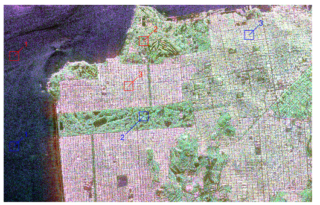{.fixed width=50%}
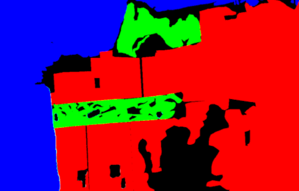{.fixed width=50%}

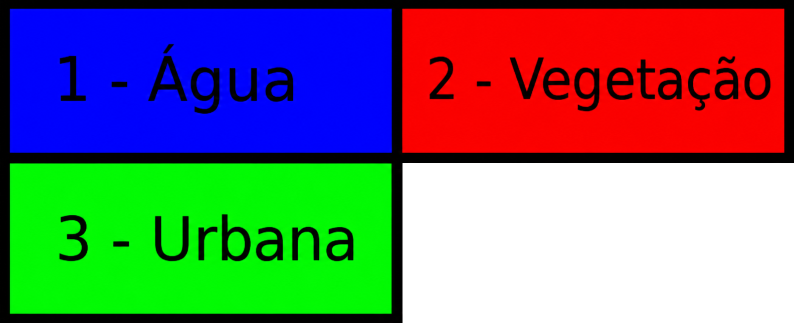{.fixed width=47%}

:::

::: {.column width="38%"}

- Adquirida pelo radar **AIRSAR** (NASA/JPL)
- **3 classes**: Água, Vegetação, Área Urbana

 

- Amostras de treino e teste: janelamento $31 \times 31$
  - **961 observações** por área
  - 2 áreas por classe (treino + teste)

 

- Variáveis: intensidades $|Z_{HH}|^2$, $|Z_{HV}|^2$, $|Z_{VV}|^2$

:::

::::

---

##
<h2 style="color:#1a3a5c;">Dados Experimentais</h2>
<h4 style="color:#7fb3d8;">Região de Foulum (EMISAR)</h4>

:::: {.columns}

::: {.column width="60%"}

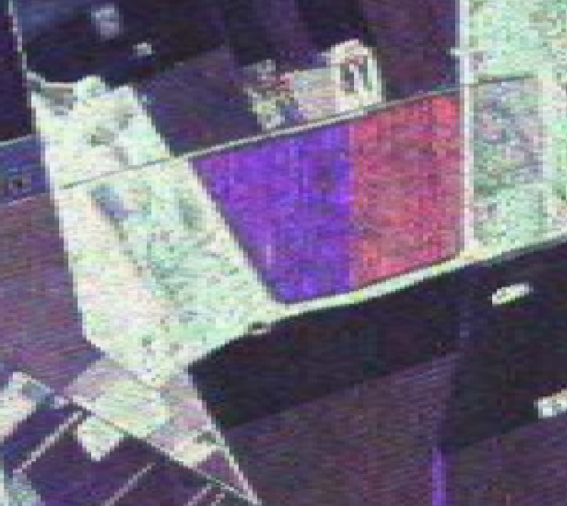{.fixed width=47%}
{.fixed width=47%}

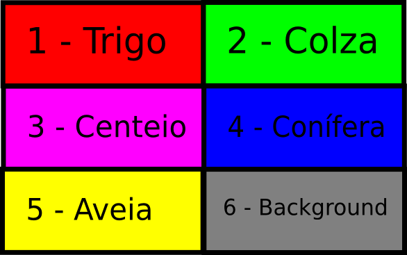{.fixed width=47%}

:::

::: {.column width="38%"}

- Sensor **EMISAR** (Dinamarca)

 

- **5 classes** de plantações

 

- 2 áreas por classe (treino + teste)

 

- Tamanhos variáveis: **961 a 1.861 pixels** por área

:::

::::

---

##
<h2 style="color:#1a3a5c;">Resultados</h2>
<h4 style="color:#7fb3d8;">Métricas de Avaliação</h4>

 

Os modelos foram avaliados com 2 métricas, adequadas ao contexto multiclasse:

:::: {.columns}

::: {.column width="45%"}

|  | Predito A | Predito B | Predito C |
|---|:---:|:---:|:---:|
| **Real A** | $n_{11}$ | $n_{12}$ | $n_{13}$ |
| **Real B** | $n_{21}$ | $n_{22}$ | $n_{23}$ |
| **Real C** | $n_{31}$ | $n_{32}$ | $n_{33}$ |

:::

::: {.column width="45%"}

| Métrica | Fórmula |
|---|---|
| **Acurácia** | $\text{Acc} = \dfrac{\sum_{i=1}^{k} n_{ii}}{N}$ |
| **Kappa** | $\kappa = \dfrac{p_o - p_e}{1 - p_e}$ |

:::

::::

em que $n_{ii}$ é o número de amostras corretamente classificadas na classe $i$, e $N$ é o total de amostras, $k$ é o número de classes, $p_o$ é a proporção de acertos observada (equivalente à acurácia) e $p_e$ é a concordância esperada ao acaso, calculada a partir da distribuição marginal das classes na matriz de confusão:

$$p_e = \sum_{i=1}^{k} \frac{(n_{i+} \times n_{+i})}{N^2}$$

em que $n_{i+}$ é é a linha $i$ e $n_{+i}$ é a coluna $j$.

---

##
<h2 style="color:#1a3a5c;">Resultados</h2>
<h4 style="color:#7fb3d8;">Resultados — São Francisco</h4>

 

| Modelo | Acurácia | Kappa |
|--------|----------|-------|
| Random Forest | 0,8318 | 0,7477 |
| TabNet | 0,8471 | 0,7706 |
| **TabR** | **0,8588** | **0,7882** |

 

. . .

<strong>Destaque:</strong> O TabR obteve o melhor desempenho global em São Francisco, com acurácia de <strong>85,88%</strong> e Kappa de <strong>0,7882</strong>.

---

##
<h2 style="color:#1a3a5c;">Resultados</h2>
<h4 style="color:#7fb3d8;">Mapas — São Francisco</h4>

:::: {.columns}

::: {.column width="33%"}

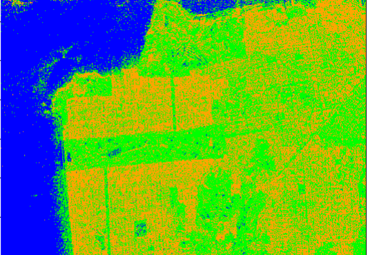{.fixed width=95%}

Melhor separação entre classes

:::

::: {.column width="33%"}

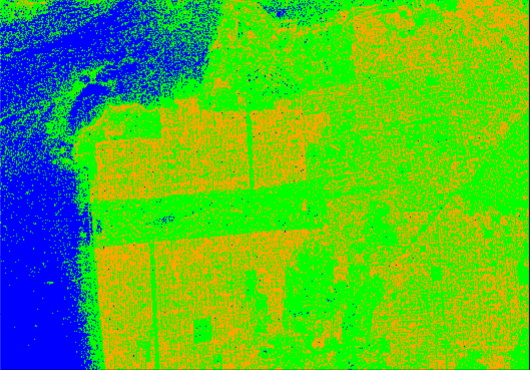{.fixed width=95%}

Suavização levemente maior

:::

::: {.column width="33%"}

{.fixed width=95%}

Maior fragmentação nas bordas

:::

::::

 

🔵 Água &emsp; 🟢 Vegetação &emsp; 🟠 Área Urbana

---

##
<h2 style="color:#1a3a5c;">Resultados</h2>
<h4 style="color:#7fb3d8;">Resultados — Foulum</h4>

 

| Modelo | Acurácia | Kappa |
|--------|----------|-------|
| TabR | 0,8649 | 0,8355 |
| Random Forest | 0,8712 | 0,8423 |
| **TabNet** | **0,8760** | **0,8489** |

 

. . .

<strong>Destaque:</strong> Para Foulum, o TabNet apresentou o melhor desempenho global, com acurácia de <strong>87,60%</strong> e Kappa de <strong>0,8489</strong>.

---

##
<h2 style="color:#1a3a5c;">Resultados</h2>
<h4 style="color:#7fb3d8;">Mapas — Foulum</h4>

:::: {.columns}

::: {.column width="33%"}

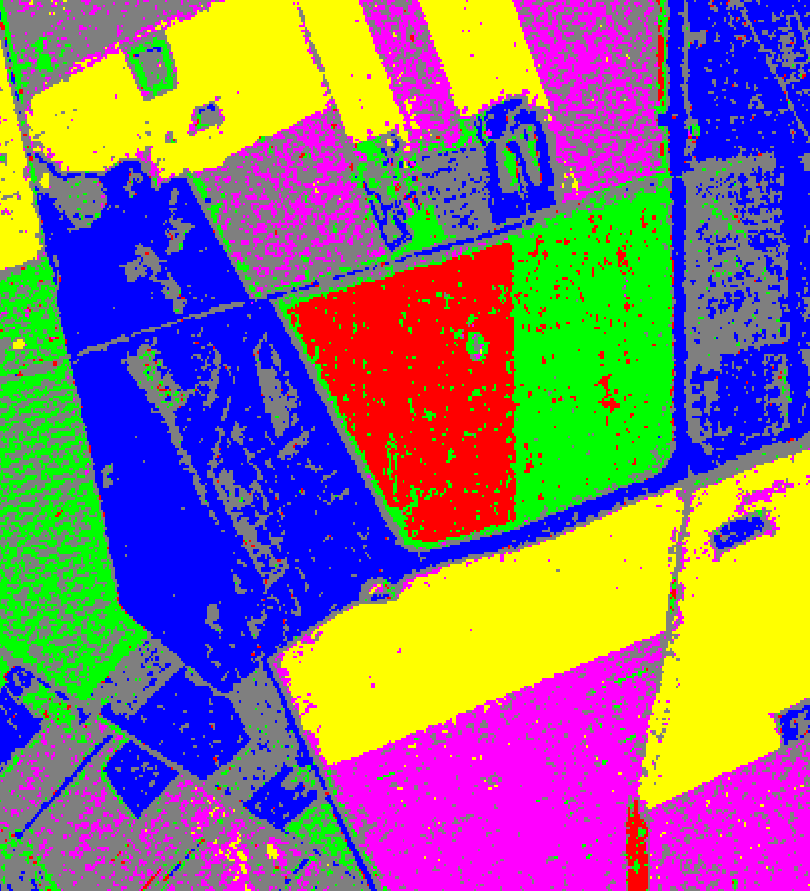{.fixed width=70% height=300px}

Boa definição de fronteiras

:::

::: {.column width="33%"}

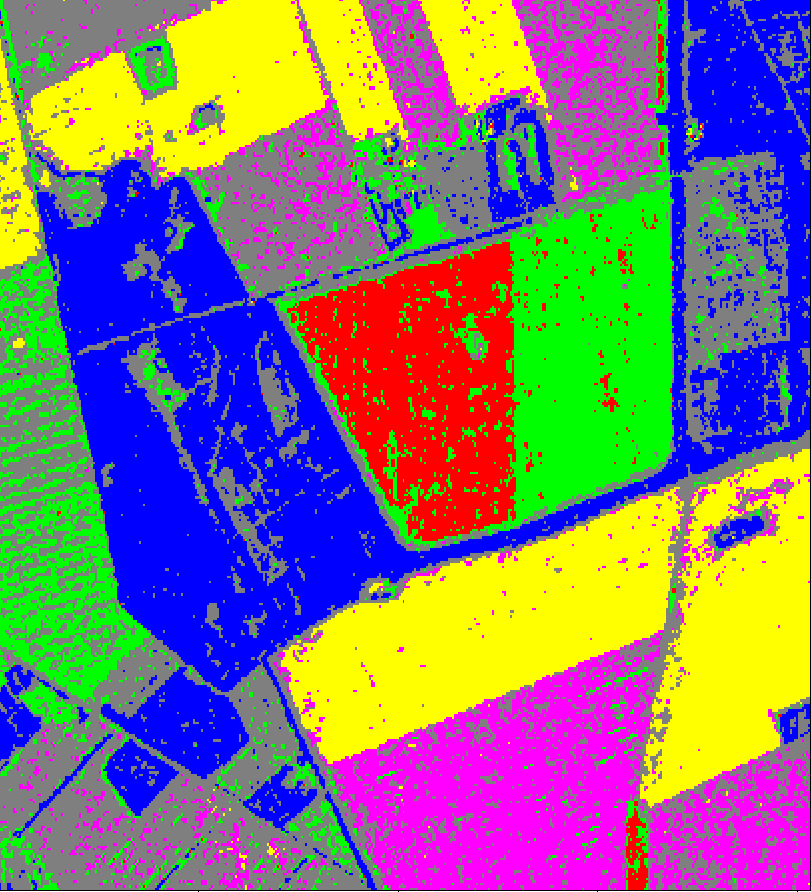{.fixed width=70% height=300px}

Melhor desempenho global

:::

::: {.column width="33%"}

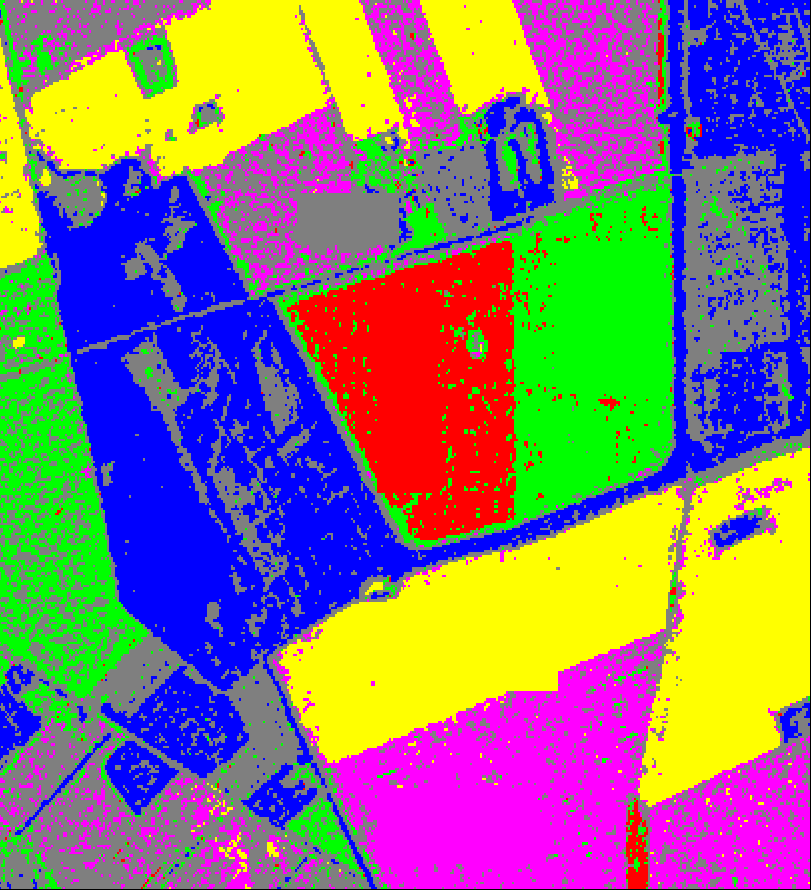{.fixed width=70% height=300px}

Maior presença de ruído

:::

::::

 

🔴 Trigo &emsp; 🟢 Colza &emsp; 🟣 Centeio &emsp; 🔵 Conífera &emsp; 🟡 Aveia &emsp; ⚫ Background

---

##
<h2 style="color:#1a3a5c;">Resultados</h2>
<h4 style="color:#7fb3d8;">Análise Comparativa</h4>

 

:::: {.columns}

::: {.column width="48%"}

<h4 style="color:#1a3a5c;">São Francisco (3 classes)</h4>

| Modelo | Acc | Kappa |
|--------|-----|-------|
| RF | 0,832 | 0,748 |
| TabNet | 0,847 | 0,771 |
| **TabR** | **0,859** | **0,788** |

 

- **TabR** se destacou com fronteiras mais claras
- Random Forest apresentou maior erro de classificação

:::

::: {.column width="48%"}

<h4 style="color:#1a3a5c;">Foulum (6 classes)</h4>

| Modelo | Acc | Kappa |
|--------|-----|-------|
| TabR | 0,865 | 0,836 |
| RF | 0,871 | 0,842 |
| **TabNet** | **0,876** | **0,849** |

 

- **TabNet** melhor em cenários com mais classes
- TabR e RF com desempenho similar

:::

::::

. . .

<strong>Observação:</strong> A superioridade varia com a complexidade da cena — o que sugere que a escolha do modelo deve ser orientada pela aplicação.

---

##
<h2 style="color:#1a3a5c;">Conclusões</h2>

 

1. O **TabR** demonstrou melhor desempenho na classificação da imagem de São Francisco (**3 classes**), com superioridade nas métricas de acurácia e Kappa.

. . .

 

2. O **TabNet** apresentou melhor desempenho na região de Foulum (**6 classes**), indicando capacidade de lidar com cenários mais complexos.

. . .

 

3. O **Random Forest** permanece competitivo, especialmente em cenários com maior variabilidade intra-classe.

. . .

 

4. Modelos de **Deep Learning para dados tabulares** (TabNet e TabR) são alternativas promissoras para classificação de dados SAR/PolSAR.

<!-- . . .

 

<strong>Contribuição:</strong> Primeiro estudo comparativo entre TabR, TabNet e Random Forest aplicados à classificação de dados SAR polarimétricos.

 -->

<!-- 
---

##
<h2 style="color:#1a3a5c;">Trabalhos Futuros</h2>

 

- Avaliar modelos em **outras cenas SAR** com mais classes e diferentes sensores

. . .

 

- Incorporar os **elementos complexos** (off-diagonal) da matriz de covariância como variáveis adicionais

. . .

 

- Investigar o impacto do **número de looks** na performance dos modelos

. . .

 

- Comparar com outras arquiteturas recentes para dados tabulares:
  - **FT-Transformer** (Gorishniy et al., 2021)
  - **SAINT** (Somepalli et al., 2021)

. . .

 

- Explorar **pré-treinamento auto-supervisionado** com TabNet decoder

--- -->

##
<h2 style="color:#1a3a5c;">Referências</h2>

- Arik, S. O. and T. Pfister (2021). **TabNet: Attentive Interpretable Tabular Learning.** *Proceedings of the AAAI Conference on Artificial Intelligence.*

- Belgiu, M. and L. Drăguţ (2016). **Random forest in remote sensing: A review.** *ISPRS J. Photogrammetry and Remote Sensing*, 114, 24–31.

- Breiman, L. (2001). **Random Forests.** *Machine Learning*, 45(1), 5–32.

- Ferreira, J. A., H. Coêlho, and A. D. Nascimento (2021). **A family of divergence-based classifiers for PolSAR imagery.** *Int. J. Remote Sensing*, 42(4), 1201–1229.

- Gorishniy, Y., I. Rubachev, et al. (2023). **TabR: Tabular deep learning meets nearest neighbors.** *arXiv preprint arXiv:2307.14338.*

- Goodfellow, I., Y. Bengio, and A. Courville (2016). **Deep Learning.** MIT Press.

- Lee, J.-S. and E. Pottier (2017). **Polarimetric Radar Imaging.** CRC Press.

- Moreira, A. et al. (2013). **A tutorial on synthetic aperture radar.** *IEEE GRSM*, 1(1), 6–43.

- Mountrakis, G., J. Im, and C. Ogole (2011). **SVMs in remote sensing: A review.** *ISPRS J.*, 66(3), 247–259.

---

## {background-color="#ffff"}

 

<h1 style="text-align: center; color:#1a3a5c;">
OBRIGADO!
</h1>

 

Jodavid Ferreira

https://jodavid.github.io | jodavid.ferreira@ufpe.br

::: {style="text-align: center; color:#7fb3d8; font-size:14pt;"}
Slide produzido com [quarto](https://quarto.org/)
:::

